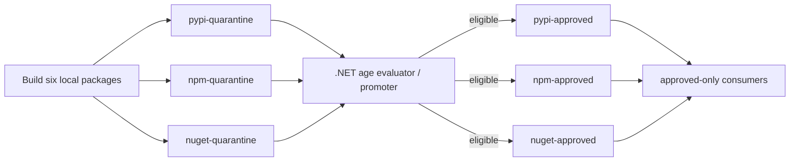

# Nexus package quarantine POC

This repository is a runnable proof of concept for a package quarantine delay across
Python, npm, and NuGet. It uses a local [Sonatype Nexus
Repository](https://www.sonatype.com/products/sonatype-nexus-repository) instance and
**six hosted repositories only**:

| Ecosystem | Quarantine repository | Approved repository |
|---|---|---|
| PyPI | `pypi-quarantine` | `pypi-approved` |
| npm | `npm-quarantine` | `npm-approved` |
| NuGet | `nuget-quarantine` | `nuget-approved` |

There are **no proxy or group repositories and no external upstreams**. Each format has
two locally generated, harmless test packages at `1.0.0`. The .NET promoter copies an
aged component from quarantine to approved; the original remains in quarantine as an
audit record.

## Architecture



The default quarantine policy is **7 days**. `QUARANTINE_PERIOD` and the promoter's
`--period` option accept an integer followed by `s`, `m`, `h`, or `d`. The demo uses a
short override such as `45s` so it does not need to wait seven days.

Eligibility is inclusive:

```text
eligible = max(component asset lastModified) + quarantine period <= observed time
```

The comparison uses the UTC-aware timestamps returned by Nexus. Exactly reaching the
boundary is eligible. Future timestamps and any age below the boundary remain
quarantined.

## Prerequisites

- Docker with Linux containers and Docker Compose v2
- PowerShell 7 (`pwsh`)
- .NET 8 SDK or later
- Python 3.8 or later
- npm 9 or later
- Approximately 3 GB of available memory and 5 GB of free disk space

The POC's application and package builders add no third-party .NET test/build
dependencies. The NuGet package fixtures have no external package dependencies.
The local Nexus image is `sonatype/nexus3:3.70.1`; the source and configuration are
in [`compose.yaml`](compose.yaml). Its image is published at
[Docker Hub](https://hub.docker.com/r/sonatype/nexus3).

## Run the complete demonstration

From the repository root:

```powershell
Copy-Item .env.example .env
pwsh -NoProfile -File ./scripts/Run-Demo.ps1 -Reset -QuarantinePeriod 45s
```

`Run-Demo.ps1`:

1. Removes the POC's dedicated Nexus Docker volume and generated artifacts.
2. Starts Nexus and initializes the development admin password.
3. Deletes Nexus's stock repositories so only the six expected hosted repositories
   remain.
4. Builds and packs two local packages for each ecosystem.
5. Publishes all six packages to the matching quarantine repository.
6. Verifies zero approved components and two quarantined components per ecosystem.
7. Runs `pip`, `npm`, and `dotnet restore` against approved-only feeds with isolated
   caches; all three commands must fail on exact version `1.0.0`.
8. Waits for the short demo period.
9. Runs the .NET promoter and copies all eligible components to approved.
10. Verifies two approved and two quarantined components per ecosystem.
11. Repeats all three consumers with new isolated caches; all three commands must
    succeed and install two packages each.

Evidence is written below `artifacts/consumer-runs/` (ignored by Git). Each phase gets a
`summary.json`, package-manager logs, cache paths, source URLs, and exit codes. The
`BeforePromotion` summaries must contain exit code `1` for all three tools; the
`AfterPromotion` summaries must contain `0`.

To keep all package tools completely independent of external feeds, package sources are
cleared in each consumer configuration. This POC does not need the private npm, PyPI,
or NuGet package registry proxies.

## Run stages manually

```powershell
Copy-Item .env.example .env
pwsh -NoProfile -File ./scripts/Test-Policy.ps1
docker compose up -d nexus
pwsh -NoProfile -File ./scripts/Initialize-Nexus.ps1
pwsh -NoProfile -File ./scripts/Build-Packages.ps1
pwsh -NoProfile -File ./scripts/Publish-Packages.ps1

pwsh -NoProfile -File ./scripts/Verify-Nexus.ps1 `
  -ExpectedQuarantineComponents 2 `
  -ExpectedApprovedComponents 0
pwsh -NoProfile -File ./scripts/Test-Consumers.ps1 -Phase BeforePromotion

# Wait at least 45 seconds.
dotnet run --project ./src/NexusQuarantine.Promoter/NexusQuarantine.Promoter.csproj -- `
  --password local-demo-only-password --period 45s

pwsh -NoProfile -File ./scripts/Verify-Nexus.ps1 `
  -ExpectedQuarantineComponents 2 `
  -ExpectedApprovedComponents 2
pwsh -NoProfile -File ./scripts/Test-Consumers.ps1 -Phase AfterPromotion
```

The promoter returns exit code `0` when every component is approved or newly promoted,
`2` when components are still pending, and `1` for configuration or Nexus errors.
This makes a one-shot invocation suitable for an external scheduler:

```powershell
dotnet run --project ./src/NexusQuarantine.Promoter/NexusQuarantine.Promoter.csproj -- `
  --password local-demo-only-password --period 7d
```

Run the promoter with `--help` for all options.

## Cache-contamination controls

The negative tests are not accepted merely because a command failed. The script also
requires the exact package-not-found messages in each tool's log:

- **pip** uses `--isolated`, `--ignore-installed`, `--no-cache-dir`, and a fresh
  `--target` directory. The generated index URL is approved-only.
- **npm** uses a new working directory, no lock file, an explicit approved-only
  `--registry`, a dedicated `--cache`, a generated user config, and no inherited
  `node_modules`.
- **NuGet** uses a generated `NuGet.Config` with `<clear />`, a fresh `NUGET_PACKAGES`
  directory, a fresh HTTP cache, a fresh `DOTNET_CLI_HOME`, `--force`, and `--no-cache`.
- Every run gets a unique, path-safe ID and reusing an existing ID is rejected. A
  global package-cache hit cannot satisfy the negative proof, and the pre- and
  post-promotion cache roots are different.

The consumer script also verifies that both packages for each ecosystem are physically
present in the phase-specific install directories after promotion.

## Configuration and credentials

The checked-in `.env.example` contains deliberately non-secret, development-only
values:

```dotenv
NEXUS_BASE_URL=http://localhost:8081
NEXUS_ADMIN_USER=admin
NEXUS_ADMIN_PASSWORD=local-demo-only-password
QUARANTINE_PERIOD=7d
DEMO_QUARANTINE_PERIOD=45s
```

Copy it to `.env`, which is ignored by Git. Never commit a real password or production
token. The initialization script changes Nexus's random first-start password to this
local value. If credentials change, keep `.env` aligned with the existing Docker
volume or reset the POC.

`NEXUS_HTTP_PORT` may override Compose's host port. If it is changed, update
`NEXUS_BASE_URL` to the same host port.

## Repository endpoints

| Tool | Quarantine endpoint | Approved endpoint |
|---|---|---|
| pip | `http://localhost:8081/repository/pypi-quarantine/simple/` | `http://localhost:8081/repository/pypi-approved/simple/` |
| npm | `http://localhost:8081/repository/npm-quarantine/` | `http://localhost:8081/repository/npm-approved/` |
| NuGet v3 | `http://localhost:8081/repository/nuget-quarantine/index.json` | `http://localhost:8081/repository/nuget-approved/index.json` |

The demonstration uses approved endpoints for consumers and quarantine endpoints only
for publishing. This separation is the policy boundary in the POC. For a production
deployment, add Nexus RBAC so consumer identities cannot read from quarantine
repositories, require HTTPS, provision secrets through a secret store, and schedule
the promoter.

## Tests

The dependency-free test executable exercises the policy boundaries:

```powershell
pwsh -NoProfile -File ./scripts/Test-Policy.ps1
```

It covers an exact seven-day boundary, one tick before that boundary, future upload
timestamps, zero and short thresholds, remaining time, negative thresholds, valid
units, malformed input, and oversized values.

## Cleanup and reset

Stop Nexus while preserving the volume:

```powershell
docker compose down
```

Stop Nexus, remove its dedicated volume, and delete generated artifacts/evidence:

```powershell
pwsh -NoProfile -File ./scripts/Reset-Demo.ps1
```

Then rerun the complete demonstration to start with an empty Nexus instance:

```powershell
pwsh -NoProfile -File ./scripts/Run-Demo.ps1 -Reset -QuarantinePeriod 45s
```

## Troubleshooting

- **Nexus is slow to start:** wait for
  `docker compose logs --follow nexus` to report that Nexus has started. Initialization
  waits up to four minutes.
- **Port 8081 is in use:** set `NEXUS_HTTP_PORT` and the matching port in
  `NEXUS_BASE_URL` in `.env`.
- **Configured password does not work:** either restore the same value from the original
  `.env` or run `Reset-Demo.ps1` to delete the local volume.
- **A consumer appears to use a package cache:** inspect the cache paths in that
  phase's `summary.json`, then run with a new `-RunId`. Do not compare the two phases
  inside the same cache directories.
- **NuGet reports `NU1302` on HTTP:** use the generated consumer config; this POC enables
  insecure localhost connections explicitly. Use HTTPS instead for non-local Nexus.
- **The promoter exits `2`:** packages are still pending. Rerun after the printed
  `eligible-at` time; no already-approved component is uploaded again.
- **Only stock Nexus repositories exist:** rerun `Initialize-Nexus.ps1`. The initializer
  intentionally removes every non-POC repository in this dedicated Docker volume.
- **Upload is rejected as duplicate:** reset, or let `Initialize-Nexus.ps1` keep the
  desired topology and publish unique local versions. The sample packages intentionally
  use the same exact version for repeatable proof.
